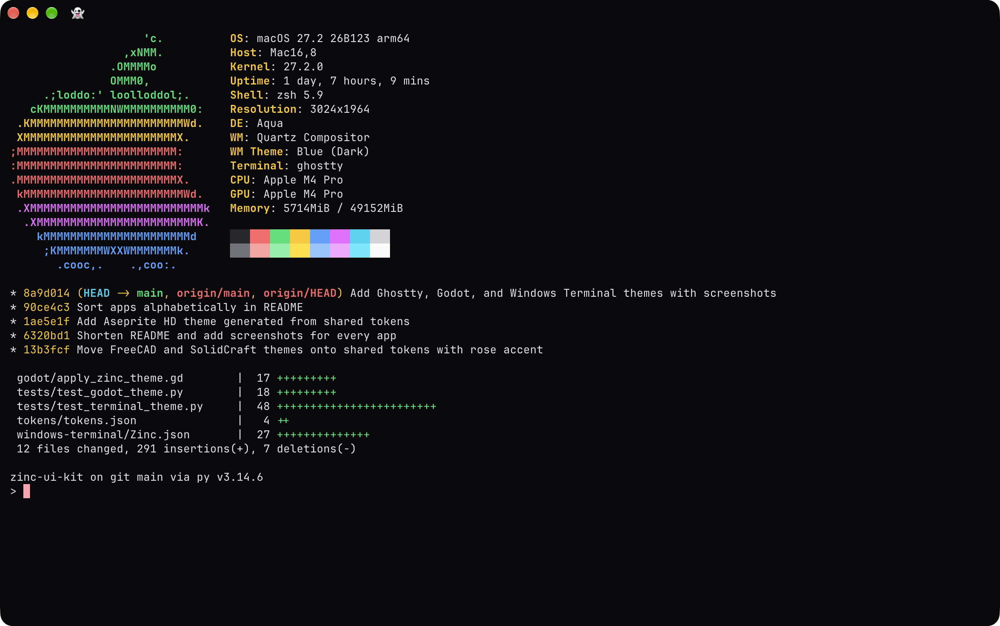
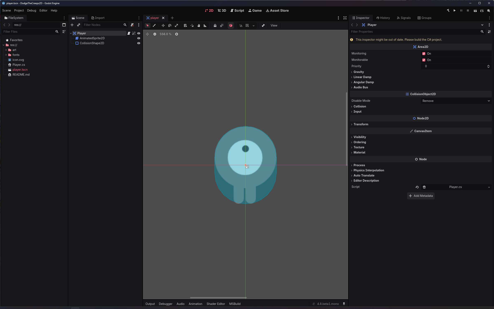
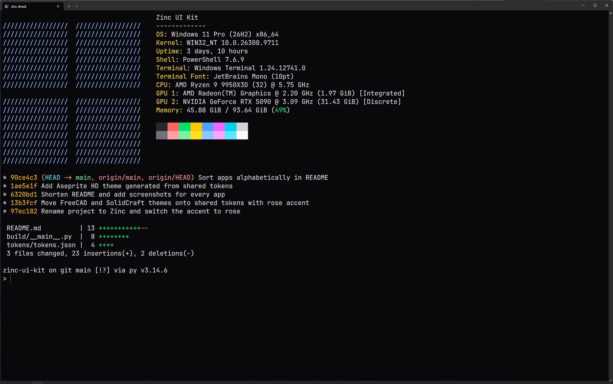

# Zinc UI Kit

A Tailwind-based theme for Aseprite 1.3, Blender 5.2, FreeCAD 1.1, Ghostty, Godot 4.8, Krita 5.3, SolidCraft, and Windows Terminal. Every app is generated from one `tokens/tokens.json`, so they all share the same zinc grays and rose accent. Nothing is forked or patched, and the default keymaps are untouched.

| Aseprite | Blender |
| --- | --- |
|  |  |
| **FreeCAD** | **Ghostty** |
|  |  |
| **Godot** | **Krita** |
|  |  |
| **SolidCraft** | **Windows Terminal** |
|  |  |

## What's in it

- Aseprite theme (`Zinc`): drawn at 2x for 100% scaling, with Lucide icons and Geist
- Blender theme (`uikit_zinc`)
- Blender add-on (`uikit_declutter`): hides tabs, panels, and workspaces by feature group, and sets the fonts
- FreeCAD preference pack (`Zinc Dark`): stylesheet, 3D view colors, and about 290 Lucide-style icons
- Ghostty theme (`Zinc`)
- Godot editor script (`apply_zinc_theme.gd`): sets the Modern style, base color, accent, and contrast
- Krita plugin (`uikit_theme`): palette, stylesheet, fonts, and a `Ctrl+K` command palette
- SolidCraft theme (`Zinc`)
- Windows Terminal color scheme (`Zinc`)

## Install

Aseprite:

1. Open `zinc-theme-0.1.0.aseprite-extension`, or add it under Edit > Preferences > Extensions.
2. Pick Zinc under Edit > Preferences > Theme.
3. Set Screen Scaling and UI Element Scaling to 100%.

A custom font set under Preferences > Theme overrides the bundled Geist.

Blender:

1. Open Preferences > Get Extensions > Install from Disk (dropdown at the top right).
2. Pick `uikit_zinc-0.2.0.zip` or `uikit_declutter-0.1.0.zip`.
3. Enable it under Preferences > Themes or Preferences > Add-ons.

The add-on's preferences have a checkbox per feature group (sculpting, painting, materials, rigging, rendering, etc). Hidden workspaces only get removed from new files, and turning the add-on off brings everything back.

FreeCAD:

1. In the Addon Manager settings, add `https://github.com/blai30/zinc-ui-kit` with branch `freecad` as a custom repository.
2. Install "Zinc Theme" and restart FreeCAD.
3. Pick Zinc Dark under Edit > Preferences > General > Theme, then restart again.

To remove the icons after switching themes, run this in the Python console and restart:

```python
App.ParamGet("User parameter:BaseApp/Preferences/Bitmaps").RemString("CustomPathZincDark")
```

Ghostty: copy `ghostty/Zinc` to `~/.config/ghostty/themes/` and add `theme = Zinc` to the config.

Godot: open `godot/apply_zinc_theme.gd` in the script editor and run File > Run. It only changes the editor theme settings, so spacing, fonts, and syntax colors stay as they are.

Krita:

1. Open Tools > Scripts > Import Python Plugin from File and pick `uikit_theme-0.1.0.zip`.
2. Enable "UI Kit Theme" in Settings > Configure Krita > Python Plugin Manager.
3. Restart Krita.

SolidCraft: import `solidcraft/Zinc.json` in the theme settings and pick Zinc.

Windows Terminal: copy `windows-terminal/Zinc.json` to `%LOCALAPPDATA%\Microsoft\Windows Terminal\Fragments\Zinc\`, restart the terminal, and pick Zinc under the profile's Appearance > Color scheme.

## Build

1. Run `python3 -m venv .venv` and `.venv/bin/pip install -r requirements-dev.txt`.
2. Run the tests with `.venv/bin/python -m pytest`.
3. Build with `.venv/bin/python -m build <target>`.

Targets are `aseprite-theme`, `blender-addon`, `blender-theme`, `fonts`, `freecad-pack`, `godot-theme`, `krita-plugin`, `solidcraft-theme`, and `terminal-themes` (Ghostty and Windows Terminal). The Blender targets need Blender installed (set `BLENDER_BIN` if it isn't in the default location). The FreeCAD, Godot, SolidCraft, and terminal targets rewrite their files in place since they install straight from the repo, and the rest go to `dist/`. Per-app color choices live in `build/*_mapping.py`.

## Known limits

- Aseprite sizes that are hardcoded rather than themed (timeline layer column, palette swatches) start out small at 100% UI scaling, but can be resized
- Blender icons, viewport selection, node, and animation colors are still stock
- FreeCAD workbench icons and less common commands use FreeCAD's own icons
- Krita docker title bars aren't restyled
- Windows Terminal fragments can't carry a window theme, so the tab bar keeps its own colors
- Only tested on macOS (Blender, Krita) and Windows (Aseprite, FreeCAD, Godot, Windows Terminal); the Ghostty theme is untested

## License

Code is GPL-3.0-or-later. Geist and JetBrains Mono are under the SIL Open Font License 1.1, bundled as "Geist UI Kit" and "JetBrains Mono UI Kit" with a few alternate glyphs baked in. The Aseprite theme builds on Aseprite's default theme, which is CC-BY-4.0, and uses Lucide icons under ISC (see `aseprite/`). The FreeCAD theme is MIT and its Lucide-derived icons are ISC (see `freecad/LICENSE`).
